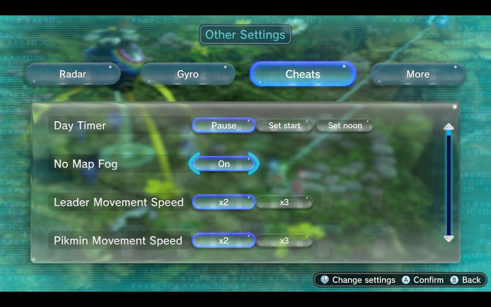
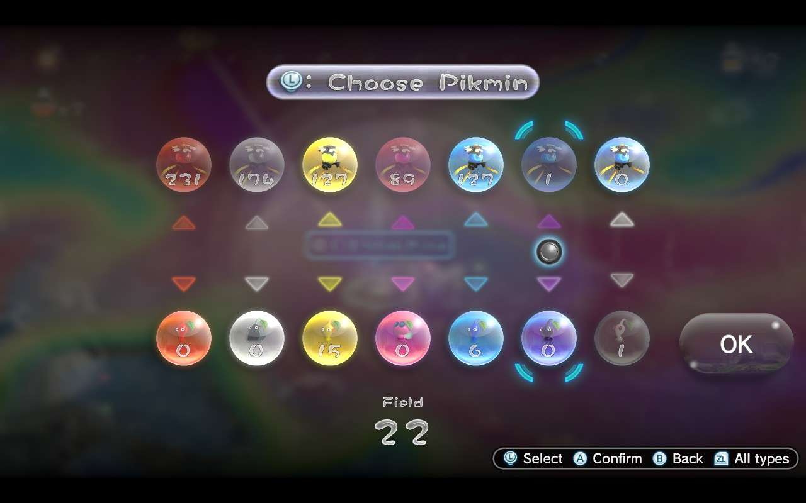

# Pikmin 3 Cheat Menu

A mod for **Pikmin 3 Deluxe** that adds a **Cheats** tab to the pause menu's Other Settings. Turn
cheats on and off while you play, and they stay the way you left them the next time you start the
game.



> [!IMPORTANT]
> This repository does not contain the mod or any of the game's files. It contains a program that
> builds the mod from your own copy of Pikmin 3 Deluxe.

## Features

- **A Cheats tab** beside Radar, Gyro and More: 42 rows, four on the page at a time, with a scroll
  bar. It opens where you left it.
- **Choices that stick.** They are kept in a small file of their own, `cheats.sav`, in the game's
  save folder. The game's own saves are not touched.
- **A day timer.** Pause the day, or set it to its start or to noon.
- **Purple and White in the Onion.** With Story Purple And White on, the Onion menu gets two more
  columns for them.
- **Pikmin on demand.** Each Onion row adds 10, 50, 100 or 1,000 flower Pikmin of its type.
- **Two cheat files** for everything else: one that comes with the mod, for what has to be set
  before the game starts (unlocks and bigger Pikmin limits), and one in a folder of its own with the
  game's leftover debug menu and test maps.



## The cheats

Press a button to turn its row to that value. Press the lit one again to turn the row off.

| Row | Buttons | What it does |
|---|---|---|
| Day Timer | Pause, Set start, Set noon | Stops the day's clock, or sets it to the start of the day or to noon |
| No Map Fog | On | The map has no fog: every place and every icon shows |
| Leader Movement Speed | x2, x3 | Leaders move that much faster |
| Pikmin Movement Speed | x2, x3 | Pikmin move that much faster |
| Leader God Mode | On | Leaders take no damage |
| Pikmin God Mode | On | Pikmin can't die |
| Hazard Immunity | On | Fire, water, electricity, poison and crushing hurt nobody, and every Pikmin swims like a Blue |
| Pikmin Attack Damage | x2, x5 | Pikmin hit that much harder |
| Pikmin Push Strength | x2, x5, x10, x100 | Each Pikmin pushes like that many |
| Pikmin Carry Strength | x2, x5, x10, x100 | Each Pikmin carries like that many |
| Pikmin Carry Speed | x2, x3, x5 | Pikmin carry things that much faster |
| Pikmin No Carry Penalty | On | Pikmin carry things at their walking speed (times Carry Speed, if that is on too) |
| Pikmin Weight | x2, x5, x10, x100 | Each Pikmin weighs like that many, wherever the game weighs Pikmin |
| Pikmin Lift Like Winged | On | Every Pikmin can lift what Winged Pikmin lift |
| Throw Distance | x2, x3, x5 | The cursor reaches that much farther, and throws go there |
| Throw Speed | x2, Max | No pause after a throw: every press of A throws a Pikmin |
| Throw Height | x2, x5 | Pikmin fly that much higher |
| Yellow Throw For All | On | Every Pikmin is thrown as high as a Yellow |
| Full-Auto Throw | On | Hold A to keep throwing, locked on or not |
| Onion Pikmin Are Flowers | On | Pikmin come out of the Onion as flowers |
| Instant Flower Sprouts | On | Sprouts in the ground are flowers straight away |
| Red Onion, Rock Onion, ... White Onion | +10, +50, +100, +1000 | Adds that many flower Pikmin to the Onion, up to 9,999 of a type |
| Story Purple And White | On | The Onion holds Purple and White Pikmin in the story |
| Instant Pikmin Pluck | On | Sprouts near a leader pop out by themselves |
| Whistle Plucks Sprouts | On | Whistle over sprouts and they come out and join you |
| Whistle Radius | x2, x5, Wii U Size | A bigger whistle, or the Wii U's smaller one |
| Invisible To Enemies | On | Enemies don't notice Pikmin or leaders |
| Freeze Healthy Enemies | On | Living enemies stand still, and can still be beaten |
| One-Hit Walls And Gates | On | Walls and gates break at the first hit |
| Pikmin Break Bomb Gates | On | Pikmin can break bomb gates |
| All Pikmin Break Crystal | On | Every Pikmin can break crystal, not only Rocks |
| All Pikmin Connect Wires | On | Every Pikmin can connect electric wires, not only Yellows |
| Infinite Spicy Spray | On | Using a spray takes none, and an empty count becomes one |
| Ultra-Spicy Spray Lasts | On | A spray's effect doesn't wear off |
| Depth Of Field Blur | Half, None | Half the blur on what is far away or very near, or none |
| No Corner Darkening | On | No dark corners around the picture |

## How it works

A cheat file's entries are written into the game's code while it runs. The game can't change its
own code, so a menu in it can't do the same. Instead, the mod changes every instruction a cheat
would change before the game starts: each one becomes a jump to a few instructions of the mod's
own, which read the row's setting and run either the game's own instruction or the cheat's. The
build makes these from the cheats themselves (`cheats/entries/rows.txt`), with the game's own
instructions read from your copy of it.

## Building the mod

You need **Python 3.10** or newer (no packages to install) and **LLVM**, for its `clang` and
`ld.lld`: the menu's own code is C. The mod was made with LLVM 18.1.8. On Windows its installer puts
them in `C:\Program Files\LLVM\bin`, where the build looks for them; elsewhere, have them on your
`PATH`, or set `LLVM_BIN` to the folder they are in.

You also need **Pikmin 3 Deluxe's RomFS and ExeFS**, extracted from your own copy of **version
1.2.0**. The mod changes that version's program, and the build stops on any other.

Then:

```bash
git clone https://github.com/rheard/pikmin-3-cheats
cd pikmin-3-cheats
python -m cheats path/to/romfs path/to/exefs
```

The build takes under a minute and writes two mod folders to `build/` (`-o` writes them somewhere
else): `Cheat Menu`, about 35 MB, and `Debug Patches`.

## Installing

Copy both folders into the game's mod folder and start the game. The tab is in the pause menu,
under Other Settings.

The two cheat files work like any other: tick an entry to turn it on. The unlocks and Pikmin limits
must be ticked before the game starts.

If you used the old all-in-one cheat file, take it out: its entries for what the menu now does would
write over the menu's own code.

To go back to the game as it was, take the folders out again. Your choices wait in `cheats.sav` for
next time.

## Known issues

- With Yellow Throw For All on, Purple Pikmin still fly their own, lower arc.
- The Onion menu's Purple and White columns show the Blue Onion under a purple or white light: the
  game has no picture of a Purple or White Onion.

## What's in here

| Path | What it does |
|---|---|
| `cheats/rows.py` | The rows of the tab: their names, their buttons and the cheats they turn on |
| `cheats/entries/` | The cheats: `rows.txt` for the menu's rows; `menu.txt` and `debug.txt`, the two cheat files |
| `cheats/switches.py` | Turns each cheat into switches the menu flips while the game runs |
| `cheats/menu/` | The menu itself, in C |
| `cheats/program.py`, `cheats/compiler.py` | Builds the menu and its switches, and the patch that points the game at them |
| `cheats/layout.py` | The tab's bubble, rows and scroll bar, and the Onion menu's two new columns |
| `cheats/game.py`, `cheats/arm.py` | Reads the game's program from your copy, and what it needs to know of its instructions |
| `cheats/formats/` | The game's file formats: archives, layouts, program files, patches and cheat files |

## The small print

This is a fan project. It is not made, endorsed or supported by Nintendo, and Pikmin and everything
about it belong to Nintendo. The code here is original and is offered under the
[MIT licence](LICENSE); none of the game's files are in it. The two pictures are screenshots of the
game with the mod. You need your own legally obtained copy of the game to use it.
